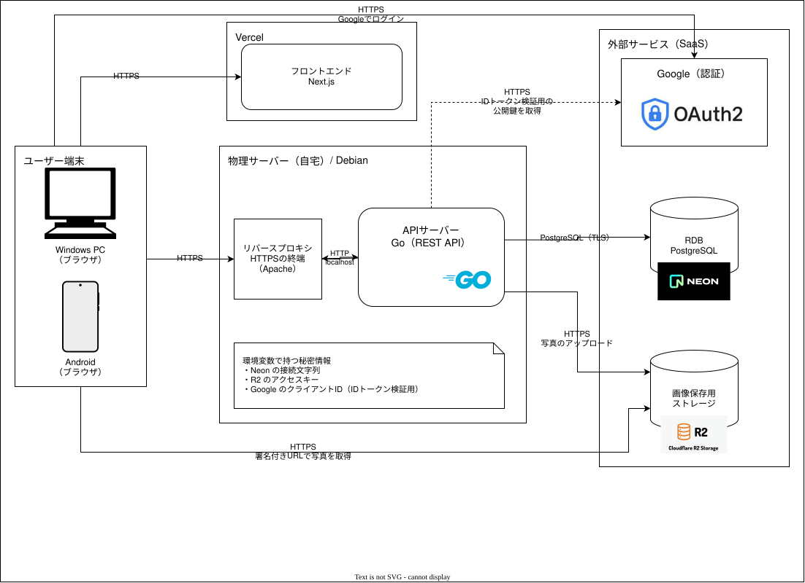

# meshi-diary

誰かとご飯を食べたときにつける日記アプリ。使うのは自分だけ（許可した Google アカウントだけがログインできる）。

背景や設計の判断は [docs/designDoc.md](docs/designDoc.md) を参照。

## できること

- Google アカウントでログインする
- 日記を書く（食事をした日・食事の区分・一言メモ・本文・写真 10 枚まで）
- カレンダーで日ごとの日記を見る（その日の写真の 1 枚目をサムネイルにする）
- 日記を編集・削除する（写真の追加・削除・並べ替え）

## 構成



| 部分 | 技術 | 置き場所 |
| --- | --- | --- |
| フロントエンド | Next.js（Vercel） | [web/](web) |
| API | Go（自宅のサーバー。Apache の後ろで systemd が動かす） | [api/](api) |
| DB | PostgreSQL（Neon、ap-southeast-1） | スキーマは [db/migrations/](db/migrations) |
| 写真 | Cloudflare R2（署名付き URL で表示する） | |
| 認証 | Google の ID トークン ＋ セッション Cookie | |

- ブラウザからの API へのリクエストは、Vercel が `/meshi-diary-api/*` を API に中継する。ブラウザからは同じオリジンに見えるので、CORS の設定が要らない
- API のデプロイは GitHub Actions で行う。フロントエンドは Vercel が master からデプロイする

## ディレクトリ

```
.
├── api/        API サーバー（Go）
├── web/        フロントエンド（Next.js）
├── db/
│   └── migrations/   DB のスキーマ（golang-migrate の SQL）
├── docs/       設計資料（Design Doc・API 仕様・テーブル定義・図・画面デザイン）
└── .github/    issue・PR のテンプレート、API のデプロイのワークフロー
```

## ドキュメント

| ファイル | 内容 |
| --- | --- |
| [docs/designDoc.md](docs/designDoc.md) | 背景・要件・技術の選定理由 |
| [docs/api.md](docs/api.md) | API の仕様 |
| [docs/table.md](docs/table.md) | テーブル定義 |
| [docs/v2.pen](docs/v2.pen) | 画面デザイン（Pencil） |
| [api/README.md](api/README.md) | API のセットアップ・環境変数・デプロイ |
| [web/README.md](web/README.md) | Vercel の設定 |

## 手元で動かす

API とフロントエンドを別々に起動する。

```sh
# API（http://127.0.0.1:8080）
cd api
cp .env.example .env   # 値を入れる。詳しくは api/README.md
make run

# フロントエンド（http://localhost:3000）
cd web
cp .env.example .env.local   # 値を入れる
npm install
npm run dev
```

開発中のフロントエンドは、`/meshi-diary-api/*` を `http://localhost:8080` に中継する（`API_BASE_URL` で変えられる）。

## プロジェクトの印象に残っているところたち
### APIサーバー、DB間の通信速度の改善
- [GitHub Issue カレンダーでサイドに日記の一覧が表示されるのが遅い](https://github.com/ShunsukeNaka/meshi-diary/issues/95)
  - [Infra: DB（Neon）を API サーバーに近いリージョンへ移す](https://github.com/ShunsukeNaka/meshi-diary/issues/97)
  - [API: DB 接続の生存確認（Ping）を減らす](https://github.com/ShunsukeNaka/meshi-diary/issues/98)

### カレンダー表示画面で一か月分のデータを一括取得
- [API・Web: カレンダーで1か月分の日記を一括で取得する](https://github.com/ShunsukeNaka/meshi-diary/issues/102)

## 開発の進め方

- 作るもの・直すものは issue に書く（[テンプレート](.github/ISSUE_TEMPLATE/task.md)）
- 1 つの issue を 1 つ以上の PR で進め、master にマージする（[PR のテンプレート](.github/pull_request_template.md)）
