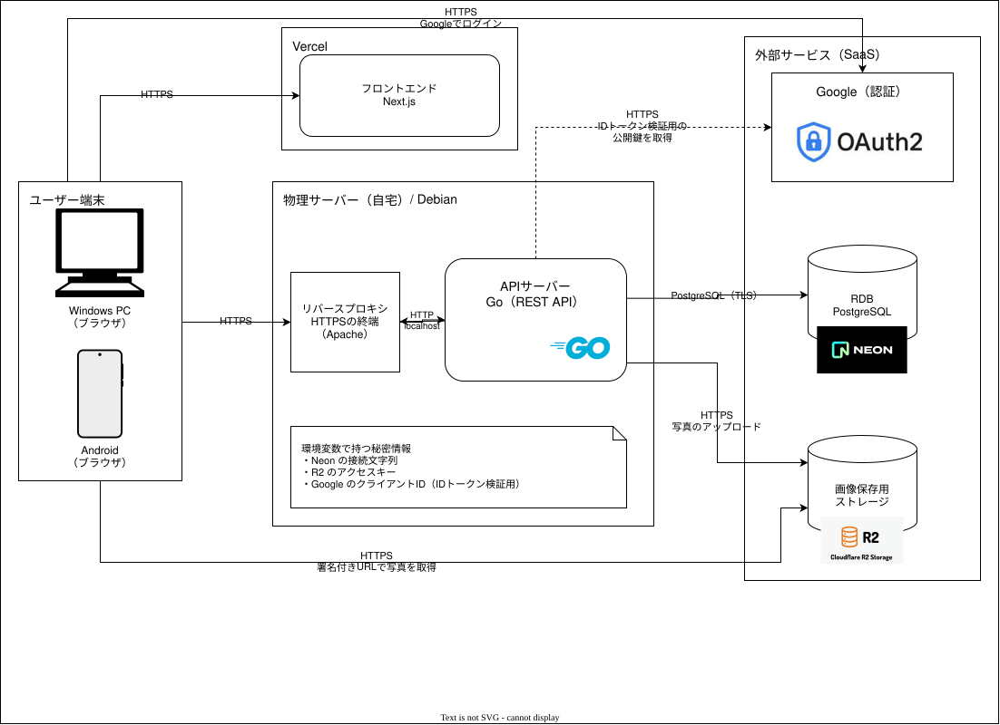
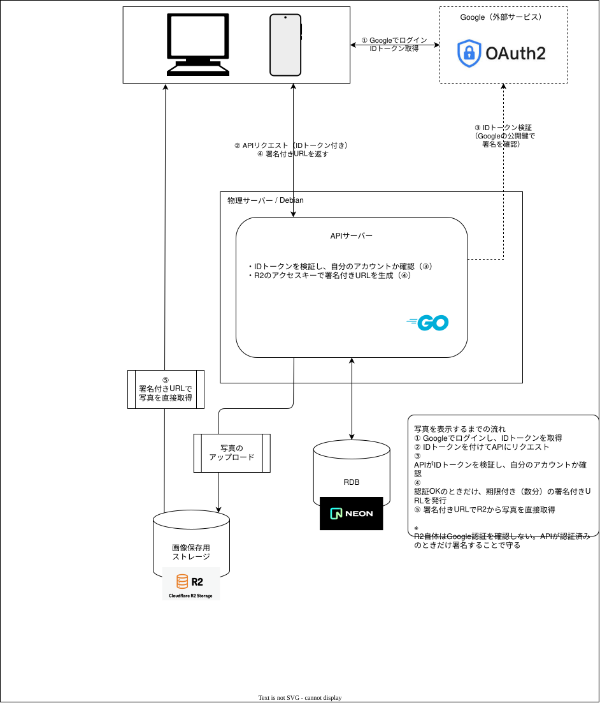
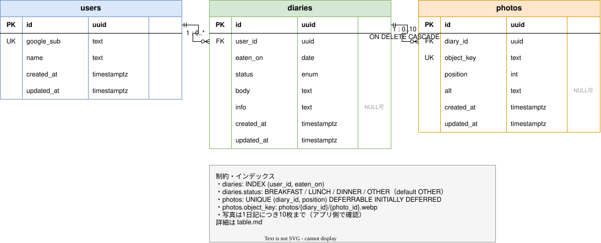
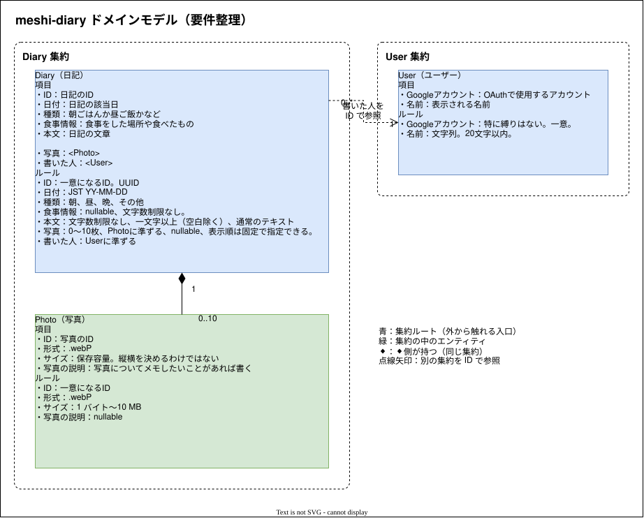

# meshi-diary Design Doc

---

## 1. 概要

誰かとご飯を食べた時に使うようの日記

## 2. 背景・課題

日記を書くこと自体は好きだが、毎日やろうと決めて続けられたことがなかった。
日記を書いたり日報を書いたりするのは楽しいが、必ず毎日書こうと決めていると書くことがないような日に「何を書こうかな」と考え込んでしまって気持ちよく書くことができない。
インターンに参加した際に昼食手当のための日報を毎日書いていて、誰かと食事をすると必ず書く内容があることに気づいたため、誰かと食事をしたときだけ日記を書くようにすれば書く内容にはこまらないと思った。
また、食事中には様々な話題が発生することや様々な人との関わりが生まれやすいこともメリットだと考える。

## 3. 目的（Goals）

- 誰かとご飯に行った際に日記をつけること

## 4. 対象外（Non-Goals）

- 必ず毎日つけようとするものではない

## 5. 想定ユーザー

- 自分のみ

## 6. 要件

### 6.1 機能要件

- ログイン
  - Google アカウントでログインする
  - 初回だけユーザー登録する（登録できるのは、許可したアカウントだけ）
- 日記を書くことができる
  - 食事をした日の選択
  - 食事の区分の選択（朝食・昼食・夕食・その他）
  - 一言メモの入力（食事をした場所や食べたもの。任意）
  - 本文の入力（生テキスト）
    - 空白以外の文字が1文字以上必要
  - 写真の登録
    - 1つの日記に10枚まで、1枚10MBまで
    - 表示する順番を指定できる
    - 写真ごとに説明を書ける（任意）
  - 保存
  - 同じ日に複数の日記を書ける（昼と夜など）
- 日記の編集・削除
  - 保存した日記をあとから編集できる
  - 写真の追加・削除・並べ替え
  - 日記の削除（登録した写真も一緒に削除する）
- 日記の表示
  - カレンダー形式で日付ごとの一覧表示
  - 月の切り替え
  - その日の登録してある写真の一枚目をサムネイルに
  - 日付を選ぶと、その日の日記の一覧を表示する
  - 日記の詳細表示（写真・食事の区分・一言メモ・本文）
- 写真アプリの「共有」から日記を書く（Android の Chrome でホーム画面に追加したとき）
  - 共有先に meshi-diary が出る。複数枚まとめて共有できる
  - 今日の日記がないとき：共有した写真が入った「日記を書く」画面が開く（日付は今日、区分は「その他」）
  - 今日の日記があるとき：新しく書くか、どの日記に追加するかを選ぶ
    - 日記を選ぶと、その日記の編集画面が、写真を今ある写真のうしろに足した状態で開く
  - 枚数・大きさ・形式が合わない写真は、写真を選んだときと同じように知らせる
  - ログインしていないときに共有した写真は残さない

### 6.2 非機能要件

<!-- パフォーマンス、セキュリティ、可用性、対応端末など -->
#### 対応端末

- Windows
- Android

## 7. 設計

### 7.1 システム構成

<!-- 全体アーキテクチャ図・構成要素 -->

### 7.2 技術スタック

| レイヤー | 技術 | 選定理由 |
| --- | --- | --- |
| フロントエンド | Next.js | 使い慣れているから |
| バックエンド | Go | GoでちゃんとしたAPIを作ったことがないのでやってみたい |
| データベース | PostgreSQL(Neon) | Supabase だと一週間使わないと一時停止される。自分で管理していてデータが消失するのが怖いのでSaaSを信頼する。 |
| ストレージ | Cloudflare R2 | 無料枠が10GBある。書き込み、読み込みの上限も十分に大きい。 |
| インフラ | 物理サーバー（API用）, Apache2（リバースプロキシ） | 標準的な？慣れている方法でGoのAPIを使いたい。高負荷な処理を行う予定はないので現在自分で管理しているサーバーで事足りそう。Apache2はもともと導入されている。 |
| インフラ | Vercel（FE公開用） | GitHubとの連携が取りやすい。自前のサーバーに置くことも可能だが、より簡単にデプロイの設定ができる点を考えて採用。 |

### 画像関連の処理

### 7.3 データモデル

<!-- ER図・テーブル定義 -->

### 7.4 API 設計

| メソッド | パス | 説明 |
| --- | --- | --- |
| ログイン | /login | |

### 7.5 画面設計

<!-- 画面一覧・画面遷移 -->

## 8. 検討した代替案

| 案 | 採用案 | メリット | デメリット | 不採用理由 |
| --- | --- | --- | --- | --- |
| Supabase | Neon,R2 | ストレージを使用できる。認証機能がある。 | 7日間使わないと一時停止される。 | 今回のアプリは7日間使用されない可能性がないとは言えないが、一時停止されるとコンソールから有効化する必要があるため。 |
| Python（Flask） | Go | 使い慣れている。コーディングが簡素。 | Goよりも事前に発見できるエラーが少ない。型の管理がない。 | 今回は自分がGoを用いたAPI開発を行いたいと考えたため不採用にした。 |
| 物理サーバーにFEデプロイ | Vercel | APIと同じドメインにできる。CORSの設定が不要になる。 | CI/CDを組む手間がVercelよりも大きい。ビルドに時間がかかる。 | 自前サーバーでデプロイが正常に完了したかを確認するのが手間。デプロイ関連にはあまり時間を割かずに開発に集中したい。 |

## 9. セキュリティ・プライバシー

### 使える人

- 自分のみ

### 認証方式

- ログイン
  - GoogleOAuth
  - 普段からGoogleアカウントログインを使用しているので自分が使いやすい。
  - NeonにはSupabaseのように認証機能がないため、自前で用意する必要がある。
    - 自前で用意しても安全に開発しやすい。Googleに任せておける。

### その他

- 画像データ
  - R2 の署名付きURLを使用する。

## 10. テスト方針

- 

## 11. 参考資料

- 
